<div align="center">

# 🚍 SmartMove™ Transport Solutions
### Enterprise Distributed Transportation Management & Transit Intelligence Platform

[](https://openjdk.org/)
[](https://spring.io/projects/spring-boot)
[](https://spring.io/projects/spring-cloud)
[](https://www.oracle.com/database/)
[](https://www.mongodb.com/)
[](https://react.dev/)
[](https://www.typescriptlang.org/)
[](https://tailwindcss.com/)
[](https://vitejs.dev/)
[](./LICENSE)

<br/>

> **High-performance polyglot transit architecture engineered for Sri Lanka's long-distance and expressway coach network.** Built with resilient Spring Boot microservices, Spring Cloud Gateway routing, Eureka service discovery, an ACID-compliant Oracle 21c transactional core, and MongoDB Atlas for unstructured fleet telemetry and publications.

---

[Key Highlights](#-key-highlights) • 
[System Architecture](#-system-architecture) • 
[Database Implementation](#-database-implementation-blueprint) • 
[Microservices Matrix](#-microservices-ecosystem) • 
[Installation Guide](#-step-by-step-setup-guide) • 
[API Reference](#-api-gateway-routes--endpoints) • 
[License & Academic Integrity](#-license--academic-integrity)

---

</div>

<br/>

## 🌟 Key Highlights

- **Polyglot Persistence Architecture**:
  - **Oracle Database 21c XE**: Manages transactional consistency across bookings, schedules, payments, vehicle maintenance records, and seat inventory with custom database triggers, PL/SQL packages, explicit cursors, and materialized views.
  - **MongoDB Atlas (Cloud NoSQL)**: Powers sentiment analytics, flexible multi-format vehicle compliance documents, high-speed announcements, and multimedia asset archiving.
- **Enterprise Microservices Suite**: 14 decoupled Spring Boot microservices coordinated seamlessly through **Spring Cloud Gateway (Port 8080)** and **Netflix Eureka Service Registry (Port 8761)**.
- **Strict ACID Transactions & Seat Locking**: Pessimistic row-locking (`FOR UPDATE`) in PL/SQL booking procedures prevents race conditions, while database triggers (`TRG_MANAGE_SEATS`) ensure real-time seat decrement/increment upon booking status transitions.
- **Modern Executive Reporting**: 5 advanced analytical reports featuring Oracle window functions (`RANK() OVER`), automated materialized view refresh, dynamic 6-month maintenance due computations, and client-side vector PDF generation (`jspdf` + `jspdf-autotable`).
- **Real-Time Passenger & Driver Portals**: Live 5-second polling telemetry, instant trip claiming with automated active vehicle dispatch, card-only payment processing, and dynamic complaint tracking linked to verifiable travel history.

---

## 🏛️ System Architecture

SmartMove operates on a distributed multi-tier microservices architecture. Client requests are proxied via a unified Spring Cloud API Gateway, which load-balances requests to registered microservice instances discovered via Netflix Eureka.

```mermaid
flowchart TD
    subgraph ClientLayer["🖥️ Presentation Tier (Port 3000)"]
        SPA["React 19 + TypeScript + Vite 8<br/>Tailwind CSS 4 • Framer Motion • Recharts"]
        AdminUI["Admin Control Hub"]
        DriverUI["Driver Duty Portal"]
        PassengerUI["Passenger Booking App"]
        SPA --> AdminUI
        SPA --> DriverUI
        SPA --> PassengerUI
    end

    subgraph GatewayLayer["🛡️ Edge & Discovery Tier"]
        GW["Spring Cloud Gateway (:8080)<br/>CORS Filter • JWT Header Relay • Dynamic Routing"]
        EUR["Eureka Service Registry (:8761)<br/>Heartbeat Discovery • Health Check Registry"]
        SPA -->|REST / JSON| GW
        GW <-->|Service Lookup| EUR
    end

    subgraph ServiceLayer["⚙️ Microservices Core (Spring Boot 3.x)"]
        AUTH["auth-service (:8081)<br/>JWT • BCrypt • Roles"]
        VEH["vehicle-service (:8082)<br/>Fleet Specifications"]
        DRV["driver-service (:8083)<br/>Driver Manifest & Profiles"]
        RTE["route-service (:8084)<br/>Route Geometry & Base Fares"]
        PAS["passenger-service (:8085)<br/>Passenger Accounts & History"]
        TRP["trip-service (:8086)<br/>Trip Schedules & Vehicle Claims"]
        BKG["booking-service (:8087)<br/>Reservations & Auto-Dispatch"]
        PAY["payment-service (:8088)<br/>Card Billing & Validation"]
        MNT["maintenance-service (:8089)<br/>Servicing Logs & Alerts"]
        FBK["feedback-service (:8090)<br/>Verified Trip Reviews"]
        REP["report-service (:8092)<br/>Executive PL/SQL Analytics"]
        CNT["content-service (:8091)<br/>NoSQL Media & Publications"]
    end

    GW --> AUTH
    GW --> VEH
    GW --> DRV
    GW --> RTE
    GW --> PAS
    GW --> TRP
    GW --> BKG
    GW --> PAY
    GW --> MNT
    GW --> FBK
    GW --> REP
    GW --> CNT

    subgraph PersistenceLayer["💾 Polyglot Data Tier"]
        subgraph OracleEngine["Oracle Database 21c XE (:1521 / xe)"]
            OTables[("Relational Schemas<br/>9 Master & Transactional Tables<br/>Sequences • Checks • Foreign Keys")]
            OProc["PL/SQL Engines<br/>TRG_MANAGE_SEATS Trigger<br/>MAKE_BOOKING (FOR UPDATE)<br/>UPDATE_COMPLETED_TRIPS Cursor<br/>MV_MONTHLY_REVENUE View"]
        end

        subgraph MongoEngine["MongoDB Atlas 7.x (Cloud / 27017)"]
            MColls[("Collections<br/>reviews • announcements<br/>vehicle_documents • trip_media")]
            MIndex["NoSQL Engines<br/>$jsonSchema Validators<br/>Full-Text Indexes<br/>$group Aggregation Pipeline"]
        end
    end

    AUTH --> OTables
    VEH --> OTables
    DRV --> OTables
    RTE --> OTables
    PAS --> OTables
    TRP --> OTables
    BKG --> OTables
    PAY --> OTables
    MNT --> OTables
    FBK --> OTables
    REP --> OProc
    CNT --> MColls
```



---

## 💾 Database Implementation Blueprint

The SmartMove data model divides responsibilities across four specialized database implementation tracks to balance structured transactional integrity with unstructured flexibility.

### 👥 Member Work Allocation Matrix

| Track | Lead Member | Primary Practical Ownership | Key Database Deliverables |
|:---|:---:|:---|:---|
| **Member 1** | **Foundation & Security** | Master Relational Tables, Sequences, Constraints, Oracle Security & User Grants | • DDL for `PASSENGER`, `DRIVER`, `VEHICLE`, `ROUTE`<br/>• `SEQ_*` primary key sequences<br/>• `smartmove_app_role` & `smartmove_user` least-privilege security<br/>• Oracle Data Pump (`expdp`/`impdp`) backup routines<br/>• Cross-database ID integrity validation queries |
| **Member 2** | **PL/SQL & Reports 1–3** | Shared PL/SQL Business Functions, Materialized Views, Reports 1–3, MongoDB Aggregations | • `CALCULATE_FARE` function with exception handling<br/>• **Report 1**: Route usage ranking with `RANK() OVER`<br/>• **Report 2**: `MV_MONTHLY_REVENUE` Materialized View & `REPORT_REVENUE` explicit cursor<br/>• **Report 3**: Passenger travel history analytics<br/>• MongoDB Query 1 & 2 (`$group` avg rating aggregation) |
| **Member 3** | **Transactions & Reports 4–5** | Transactional Tables, Database Triggers, Atomic Booking Procedure, Reports 4–5 | • DDL for `TRIP`, `BOOKING`, `PAYMENT`, `MAINTENANCE`, `FEEDBACK`<br/>• `TRG_MANAGE_SEATS` automated inventory trigger<br/>• `MAKE_BOOKING` procedure with `FOR UPDATE` locking<br/>• `UPDATE_COMPLETED_TRIPS` explicit cursor FOR loop<br/>• **Report 4**: Vehicles due for maintenance (`ADD_MONTHS`)<br/>• **Report 5**: Trip occupancy & performance revenue |
| **Member 4** | **NoSQL & Advanced Queries** | MongoDB Collections, Document Schemas, Text Indexes, NoSQL Queries 3–4 | • Collections: `reviews`, `announcements`, `vehicle_documents`, `trip_media`<br/>• `$jsonSchema` document structure validators<br/>• Full-text search index on complaint keywords<br/>• Nested document manipulation (`$set`, `$addToSet`)<br/>• Multi-attribute vehicle compliance & multimedia retrieval |

---

### 🛢️ 1. Oracle 21c Relational Schema Specification

All relational tables utilize primary keys generated from sequential sequences, explicit foreign keys with referential integrity, and domain check constraints.

```
┌──────────────┐       ┌──────────────┐       ┌──────────────┐
│  PASSENGER   │       │    ROUTE     │       │   VEHICLE    │
├──────────────┤       ├──────────────┤       ├──────────────┤
│PASSENGER_ID* │◄──┐   │ROUTE_ID*     │◄──┐   │VEHICLE_ID*   │◄──┐
│FIRST_NAME    │   │   │ORIGIN        │   │   │REG_NUMBER (U)│   │
│LAST_NAME     │   │   │DESTINATION   │   │   │CAPACITY      │   │
│EMAIL (U)     │   │   │DISTANCE_KM   │   │   │STATUS        │   │
│PASSWORD_HASH │   │   │BASE_FARE     │   │   └──────┬───────┘   │
└──────────────┘   │   └──────┬───────┘   │          │           │
                   │          │           │          │           │
┌──────────────┐   │          │           │   ┌──────┴───────┐   │
│    DRIVER    │   │          │           │   │ MAINTENANCE  │   │
├──────────────┤   │          │           │   ├──────────────┤   │
│DRIVER_ID*    │   │          │           │   │MAINT_ID*     │   │
│FIRST_NAME    │   │          │           │   │VEHICLE_ID (F)├───┘
│LICENSE_NO (U)│   │          │           │   │COST, DATE    │
│STATUS, RATING│   │          │           │   └──────────────┘
└──────┬───────┘   │          │           │
       │           │          │           │
       │           │   ┌──────┴───────┐   │
       │           │   │     TRIP     │   │
       │           │   ├──────────────┤   │
       │           │   │TRIP_ID*      │   │
       │           │   │ROUTE_ID (FK) ├───┘
       │           │   │VEHICLE_ID(FK)├──┐
       └───────────┼───┤DRIVER_ID (FK)│  │
                   │   │DEPARTURE_TIME│  │
                   │   │AVAILABLE_SEATS  │
                   │   │STATUS        │  │
                   │   └──────┬───────┘  │
                   │          │          │
                   │   ┌──────┴───────┐  │
                   │   │   BOOKING    │  │
                   │   ├──────────────┤  │
                   └───┤PASSENGER_ID  │  │
                       │TRIP_ID (FK)  │  │
                       │SEATS_BOOKED  │  │
                       │TOTAL_FARE    │  │
                       │STATUS, PMT_ST│  │
                       └──────┬───────┘  │
                              │          │
                       ┌──────┴───────┐  │
                       │   PAYMENT    │  │
                       ├──────────────┤  │
                       │PAYMENT_ID*   │  │
                       │BOOKING_ID(FK)│  │
                       │AMOUNT        │  │
                       │STATUS        │  │
                       └──────────────┘  │
                                         │
┌──────────────┐                         │
│   FEEDBACK   │                         │
├──────────────┤                         │
│FEEDBACK_ID*  │                         │
│PASSENGER_ID  │                         │
│TRIP_ID (FK)  ├─────────────────────────┘
│TYPE, STATUS  │
└──────────────┘
```

<details>
<summary><b>📋 View Detailed Relational Table Specifications & DDL</b></summary>

#### Table Catalog:
1. **`PASSENGER`**: Passenger accounts, BCrypt passwords, role defaults (`PASSENGER`), account statuses (`ACTIVE`, `INACTIVE`, `SUSPENDED`).
2. **`DRIVER`**: Fleet captain records, commercial driving license number, star rating (1.0 to 5.0), total trips counter, status (`ACTIVE`, `INACTIVE`, `ON_TRIP`, `ON_LEAVE`).
3. **`VEHICLE`**: Fleet assets, registration number (`ND-XXXX`), seating capacity, bus model/year, status (`ACTIVE`, `INACTIVE`, `MAINTENANCE`).
4. **`ROUTE`**: Origin and destination cities, highway distance in km, estimated travel duration, base fare in LKR.
5. **`TRIP`**: Operating schedules linking Route, Vehicle, and Driver. Tracks departure/arrival timestamps, available seats count, and status (`SCHEDULED`, `IN_PROGRESS`, `COMPLETED`, `CANCELLED`).
6. **`BOOKING`**: Seat reservations made by passengers. Tracks number of seats, calculated total fare, booking status (`PENDING`, `CONFIRMED`, `CANCELLED`), and payment status (`UNPAID`, `PAID`, `REFUNDED`).
7. **`PAYMENT`**: Financial transaction ledgers. Stores booking reference, amount, payment method (`CARD`), payment status (`SUCCESS`, `FAILED`, `REFUNDED`), and unique transaction UUID.
8. **`MAINTENANCE`**: Preventative and reactive maintenance servicing logs. Stores vehicle reference, description, cost, maintenance date, and status (`PENDING`, `IN_PROGRESS`, `COMPLETED`).
9. **`FEEDBACK`**: Passenger feedback tickets. Captures trip reference, ticket type (`COMPLAINT`, `SUGGESTION`, `APPRECIATION`), textual description, and resolution state (`OPEN`, `REVIEWING`, `RESOLVED`).

</details>

---

### ⚡ 2. PL/SQL Stored Logic & Automation

#### A. Database Trigger: Real-Time Seat Capacity Manager
The `TRG_MANAGE_SEATS` trigger ensures zero seat leakage by automatically decrementing or incrementing trip inventory inside the database kernel:

```sql
CREATE OR REPLACE TRIGGER TRG_MANAGE_SEATS
    AFTER INSERT OR UPDATE OF STATUS ON BOOKING
    FOR EACH ROW
BEGIN
    -- Automatically decrease available seats when booking is confirmed
    IF INSERTING AND :NEW.STATUS = 'CONFIRMED' THEN
        UPDATE TRIP SET AVAILABLE_SEATS = AVAILABLE_SEATS - :NEW.SEATS_BOOKED 
        WHERE TRIP_ID = :NEW.TRIP_ID;
    -- Restock available seats if a confirmed booking is cancelled
    ELSIF UPDATING AND :OLD.STATUS = 'CONFIRMED' AND :NEW.STATUS = 'CANCELLED' THEN
        UPDATE TRIP SET AVAILABLE_SEATS = AVAILABLE_SEATS + :OLD.SEATS_BOOKED 
        WHERE TRIP_ID = :OLD.TRIP_ID;
    END IF;
END;
/
```

#### B. Pessimistic Row-Locking Booking Procedure (`MAKE_BOOKING`)
Prevents double-booking concurrency conflicts by locking the trip row with `FOR UPDATE`:

```sql
CREATE OR REPLACE PROCEDURE MAKE_BOOKING(
    p_passenger_id IN NUMBER, 
    p_trip_id      IN NUMBER, 
    p_seats        IN NUMBER
) IS
    v_avail_seats NUMBER;
    v_route_id    NUMBER;
    v_fare        NUMBER;
BEGIN
    -- 1. Pessimistic Lock on target trip row
    SELECT AVAILABLE_SEATS, ROUTE_ID INTO v_avail_seats, v_route_id
    FROM TRIP WHERE TRIP_ID = p_trip_id FOR UPDATE;

    -- 2. Capacity validation
    IF v_avail_seats < p_seats THEN
        RAISE_APPLICATION_ERROR(-20002, 'Insufficient available seats.');
    END IF;

    -- 3. Compute dynamic fare using Member 2's function
    v_fare := CALCULATE_FARE(v_route_id, p_seats);

    -- 4. Create confirmed booking record
    INSERT INTO BOOKING (PASSENGER_ID, TRIP_ID, SEATS_BOOKED, TOTAL_FARE, STATUS, PAYMENT_STATUS)
    VALUES (p_passenger_id, p_trip_id, p_seats, v_fare, 'CONFIRMED', 'UNPAID');

    COMMIT;
EXCEPTION
    WHEN NO_DATA_FOUND THEN
        ROLLBACK;
        RAISE_APPLICATION_ERROR(-20003, 'Requested trip does not exist.');
    WHEN OTHERS THEN
        ROLLBACK;
        RAISE;
END MAKE_BOOKING;
/
```

#### C. Automated Trip Lifecycle Cursor (`UPDATE_COMPLETED_TRIPS`)
An explicit cursor that evaluates arrival timestamps against `SYSDATE` and transitions trips to `COMPLETED`:

```sql
CREATE OR REPLACE PROCEDURE UPDATE_COMPLETED_TRIPS IS
    CURSOR c_past_trips IS
        SELECT TRIP_ID, DEPARTURE_TIME FROM TRIP
        WHERE STATUS IN ('SCHEDULED', 'IN_PROGRESS') AND ARRIVAL_TIME < SYSDATE;
BEGIN
    FOR trip_rec IN c_past_trips LOOP
        UPDATE TRIP SET STATUS = 'COMPLETED' WHERE TRIP_ID = trip_rec.TRIP_ID;
        DBMS_OUTPUT.PUT_LINE('Trip ' || trip_rec.TRIP_ID || ' auto-marked as COMPLETED.');
    END LOOP;
    COMMIT;
END UPDATE_COMPLETED_TRIPS;
/
```

---

### 📊 3. The 5 Executive Business Reports

| Report # | Title | Primary SQL / PL/SQL Mechanism | Business Value |
|:---:|:---|:---|:---|
| **Report 1** | **Most Frequently Used Routes** | Analytic Window Function: `RANK() OVER (ORDER BY COUNT(b.BOOKING_ID) DESC)` | Identifies high-demand corridors to optimize frequency and coach allocation. |
| **Report 2** | **Revenue within a Period** | Materialized View (`MV_MONTHLY_REVENUE`) & `REPORT_REVENUE` Cursor | Eliminates repeated expensive aggregations on payment tables for admin financial audits. |
| **Report 3** | **Passenger Travel History** | Multi-table joins across `PASSENGER`, `BOOKING`, `TRIP`, `ROUTE`, `PAYMENT` | Provides customer lifetime value (LTV), total trips completed, and repeat rider patterns. |
| **Report 4** | **Vehicles Due for Maintenance** | Dynamic Date Arithmetic: `ADD_MONTHS(MAX(m.MAINTENANCE_DATE), 6) < SYSDATE` | Enforces proactive fleet safety compliance by detecting coaches exceeding the 6-month servicing limit. |
| **Report 5** | **Trip Occupancy & Performance** | Revenue & Seat Metric: `ROUND(((CAPACITY - AVAILABLE_SEATS) / CAPACITY) * 100, 2)` | Identifies underutilized departures vs profitable full-capacity express runs. |

---

### 🍃 4. MongoDB Atlas NoSQL Implementation

MongoDB Atlas is deployed alongside Oracle to manage high-volume unstructured documents, nested compliance records, customer sentiment, and operational notices.

#### A. Document Collections
1. **`reviews`**: Passenger ratings (1 to 5), textual feedback, tagged topics (`"On Time"`, `"Comfortable"`, `"Clean"`), route/vehicle/driver references.
2. **`announcements`**: System bulletins, scheduled maintenance alerts, highway roadwork advisories with audience filtering (`ALL`, `PASSENGERS`, `DRIVERS`, `ADMIN`).
3. **`vehicle_documents`**: Nested compliance portfolios per vehicle (Insurance certificates, revenue licenses, fitness certificates, high-res photos).
4. **`trip_media`**: Dashcam telemetry images, terminal departure photos, luggage compartment media.

#### B. The 4 Essential NoSQL Query Demonstrations

```javascript
// Query 1: Retrieve all passenger sentiment and reviews for a specified route
db.reviews.find({ routeId: 1 }).sort({ createdAt: -1 });

// Query 2: Aggregation Pipeline - Rank vehicles with highest average customer rating
db.reviews.aggregate([
  { $group: { _id: "$vehicleId", avgRating: { $avg: "$rating" }, totalReviews: { $sum: 1 } } },
  { $sort: { avgRating: -1, totalReviews: -1 } },
  { $limit: 10 }
]);

// Query 3: Full-Text Keyword Search across complaints & sentiment
db.reviews.find(
  { $text: { $search: "delay late breakdown ac" } },
  { score: { $meta: "textScore" } }
).sort({ score: { $meta: "textScore" } });

// Query 4: Retrieve active compliance documents for a specific vehicle
db.vehicle_documents.find({ 
  vehicleId: 1, 
  status: "VALID" 
}, { 
  fileName: 1, url: 1, uploadedAt: 1, _id: 0 
});
```

---

## 🌐 Microservices Ecosystem

Every microservice in SmartMove is completely decoupled, maintaining its own Spring Boot application context, HikariCP/UCP connection pools, and REST controllers.

| Service Name | Port | Primary Database | Gateway Route Path | Primary Business Domain |
|:---|:---:|:---:|:---|:---|
| **`service-registry`** | `8761` | — | Discovery Dashboard (`/`) | Eureka Discovery Server & service health registry |
| **`api-gateway`** | `8080` | — | `/api/**` | Spring Cloud Gateway, global CORS, request dispatch |
| **`auth-service`** | `8081` | Oracle 21c | `/api/auth/**` | JWT token issuing, BCrypt verification, role claims |
| **`vehicle-service`** | `8082` | Oracle 21c | `/api/vehicles/**` | Bus fleet inventory, specifications, and availability |
| **`driver-service`** | `8083` | Oracle 21c | `/api/drivers/**` | Captain profiles, ratings, duty manifests, security |
| **`route-service`** | `8084` | Oracle 21c | `/api/routes/**` | Route stops, kilometer distance, base fare computation |
| **`passenger-service`** | `8085` | Oracle 21c | `/api/passengers/**` | Passenger profiles and historical travel records |
| **`trip-service`** | `8086` | Oracle 21c | `/api/trips/**` | Departure schedules, driver trip claiming & vehicle dispatch |
| **`booking-service`** | `8087` | Oracle 21c | `/api/bookings/**` | Ticket reservations, seats validation, auto trip creation |
| **`payment-service`** | `8088` | Oracle 21c | `/api/payments/**` | Card payment processing and transactional receipts |
| **`maintenance-service`**| `8089` | Oracle 21c | `/api/maintenance/**`| Servicing logs, repair cost tracking, due alerts |
| **`feedback-service`** | `8090` | Oracle 21c | `/api/feedback/**` | Verified passenger complaint and rating tickets |
| **`content-service`** | `8091` | MongoDB Atlas | `/api/reviews/**`<br/>`/api/announcements/**`<br/>`/api/documents/**`<br/>`/api/media/**` | Unstructured publications, reviews, media & docs |
| **`report-service`** | `8092` | Oracle 21c | `/api/reports/**` | Executive business intelligence Reports 1–5 |
| **`smartmove-web`** | `3000` | — | Frontend SPA | React 19 client application (proxies to :8080) |

---

## 🚀 Step-by-Step Setup Guide

### 📋 Prerequisites

Before setting up SmartMove, ensure the following development runtimes are installed:

- **Java Development Kit (JDK)**: Java 17 LTS (`java -version` &rarr; OpenJDK 17+)
- **Apache Maven**: 3.9+ (`mvn -version`)
- **Node.js**: 20+ LTS (`node -v` & `npm -v`)
- **Oracle Database 21c Express Edition (XE)**: Port 1521 (SID: `xe` or Pluggable DB `XEPDB1`)
- **MongoDB**: MongoDB Atlas cloud cluster (configured in `application.properties`) or local MongoDB on port 27017.

---

### Step 1: Clone Repository

```bash
git clone https://github.com/NimnaOfficial/SmartMove.git
cd SmartMove
```

---

### Step 2: Database Initialization

#### A. Oracle 21c XE Setup
Connect to your local Oracle Database instance using SQL*Plus or SQL Developer as `SYSTEM`:

```sql
-- 1. Create or reset schema tables using the executable script
@database_SQL_noSQL_PLSQL/member1/orcale.sql
@database_SQL_noSQL_PLSQL/member2/orcale.sql
@database_SQL_noSQL_PLSQL/member3/orcale.sql

-- 2. Populate realistic production test data
@docs/database/Oracle_TestData.sql
```

#### B. MongoDB Atlas / Local Setup
Using `mongosh` or MongoDB Compass:

```javascript
// Run the MongoDB schema initialization and test data script
load("docs/mongodb/Mongo_TestData.js");
```

---

### Step 3: Compile Backend & Install Frontend

#### Compile All 15 Microservices:
```powershell
mvn clean compile -DskipTests
```
*(Expected output: `BUILD SUCCESS` across all 15 modules in < 10 seconds)*

#### Install Frontend Dependencies:
```powershell
cd frontend/smartmove-web
npm install
cd ../..
```

---

### Step 4: 1-Click System Launch 🚀

SmartMove includes silent PowerShell orchestration scripts that start all 14 Spring Boot microservices in the background, redirect logs to dedicated files, and launch the Vite frontend:

```powershell
.\start_all.ps1
```

To stop all services and free all ports cleanly:
```powershell
.\stop_all.ps1
```

> [!TIP]
> **Manual Development Mode**:
> If you prefer running the frontend in interactive development mode:
> ```powershell
> cd frontend\smartmove-web
> npm run dev
> ```
> Visit your application at **`http://localhost:3000`**.

---

## 🔑 Default Test Accounts & Credentials

The seed data provides verified test accounts with pre-hashed credentials (`password123`):

| Role | Email Address | Password | Description / Capabilities |
|:---|:---|:---|:---|
| **Administrator** | `admin@smartmove.lk` | `password123` | Full access to Admin Hub, Executive Reports, Fleet, Routes, Dispatch, and Content Store |
| **Driver / Captain**| `saman.k@smartmove.lk` | `password123` | Access to Driver Duty Portal, schedule claiming, active trip telemetry, notifications |
| **Passenger** | `nimal@example.com` | `password123` | Trip search, seat reservation, card payments, travel history, verified review submission |
| **Passenger** | `sunil@example.com` | `password123` | Secondary passenger with confirmed expressway bookings |

---

## 📡 API Gateway Routes & Endpoints

All external client traffic routes through Spring Cloud Gateway on **`http://localhost:8080`**:

| Method | Endpoint | Microservice Destination | Description |
|:---:|:---|:---|:---|
| `POST` | `/api/auth/login` | `auth-service` (:8081) | Authenticates user and returns JWT bearer token |
| `POST` | `/api/auth/register` | `auth-service` (:8081) | Registers passenger accounts with BCrypt salt |
| `GET` | `/api/vehicles` | `vehicle-service` (:8082) | Lists all fleet vehicles and operational status |
| `GET` | `/api/drivers/profile` | `driver-service` (:8083) | Retrieves authenticated driver's profile and stats |
| `PUT` | `/api/drivers/profile` | `driver-service` (:8083) | Updates driver profile fields while preserving DB constraints |
| `GET` | `/api/routes` | `route-service` (:8084) | Retrieves active transit corridors and base fares |
| `GET` | `/api/trips` | `trip-service` (:8086) | Retrieves all scheduled trips with route/vehicle enrichment |
| `GET` | `/api/trips/available` | `trip-service` (:8086) | Real-time feed of open trips waiting for driver claiming |
| `POST`| `/api/trips/{id}/claim` | `trip-service` (:8086) | Assigns driver and available coach, sets status to `SCHEDULED` |
| `POST`| `/api/bookings` | `booking-service` (:8087) | Reserves seats, calculates fare, initiates dispatch |
| `POST`| `/api/payments` | `payment-service` (:8088) | Processes card transaction and sets booking to `PAID` |
| `GET` | `/api/reports/routes` | `report-service` (:8092) | **Report 1**: Route usage ranking (`RANK() OVER`) |
| `GET` | `/api/reports/revenue` | `report-service` (:8092) | **Report 2**: Revenue analytics from `MV_MONTHLY_REVENUE` |
| `GET` | `/api/reports/passengers` | `report-service` (:8092) | **Report 3**: Passenger analytics and lifetime spend |
| `GET` | `/api/reports/maintenance`| `report-service` (:8092) | **Report 4**: Vehicles due for maintenance (`ADD_MONTHS`) |
| `GET` | `/api/reports/occupancy` | `report-service` (:8092) | **Report 5**: Trip occupancy percentage and generated revenue |
| `GET` | `/api/announcements` | `content-service` (:8091) | MongoDB real-time bulletin and announcement feed |
| `POST`| `/api/announcements` | `content-service` (:8091) | Publishes new announcement to MongoDB with ISO timestamps |
| `PUT` | `/api/announcements/{id}` | `content-service` (:8091) | Updates announcement by BSON `ObjectId` or string ID |
| `GET` | `/api/reviews` | `content-service` (:8091) | Retrieves all passenger sentiment records |
| `GET` | `/api/reviews/top-rated` | `content-service` (:8091) | Aggregation pipeline ranking highest-rated fleet coaches |

---

## 🔒 License & Academic Integrity

```
================================================================================
SMARTMOVE™ TRANSPORT SOLUTIONS PROPRIETARY & ACADEMIC INTEGRITY LICENSE
COPYRIGHT (C) 2026 NIMNA & SMARTMOVE CORE ENGINEERING TEAM. ALL RIGHTS RESERVED.
NATIONAL INSTITUTE OF BUSINESS MANAGEMENT (NIBM) — HIGHER NATIONAL DIPLOMA IN SOFTWARE ENGINEERING
MODULE: DATA MANAGEMENT II (DM2)
================================================================================
```

> [!CAUTION]
> ### STRICT ANTI-PLAGIARISM & ANTI-COPY ENFORCEMENT
> This software, database architecture (Oracle SQL, PL/SQL packages, MongoDB schemas, triggers, materialized views), backend microservices, and user interface designs are submitted as an original coursework project for the **Higher National Diploma in Software Engineering (HNDSE)** at the **National Institute of Business Management (NIBM)**.
>
> 1. **STRICT PROHIBITION ON COPYING FOR ACADEMIC SUBMISSION**:
>    No student, individual, or academic participant is permitted to copy, duplicate, adapt, translate, disguise, or submit any portion of this code, database implementation, reports, or documentation as their own coursework, examination, or viva deliverable at NIBM or any other educational institution worldwide.
> 2. **NO COMMERCIAL REPRODUCTION**:
>    Unauthorized commercialization, redistribution, SaaS hosting, resale, or public mirroring of this repository without express written authorization is strictly prohibited.
> 3. **DIGITAL FINGERPRINTING**:
>    This codebase and schema utilize specific cryptographic salts, custom constraint sequencing algorithms, and telemetry data models designed to trigger positive detections in automated code similarity engines (Turnitin, MOSS, AST Analyzers).
>
> For full legal terms, consult the official [LICENSE](./LICENSE) document.

---

<div align="center">

**SmartMove™ Transport Solutions** • Developed with pride for **NIBM Data Management II (DM2)**  
*Next-Generation Public Transportation Engineering*

</div>
