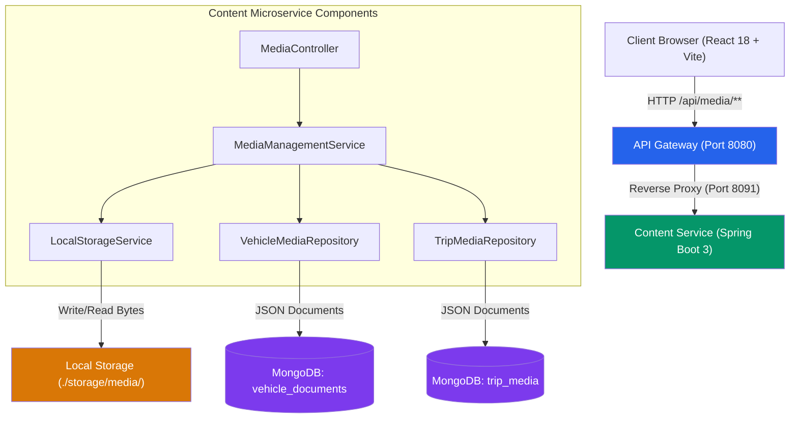
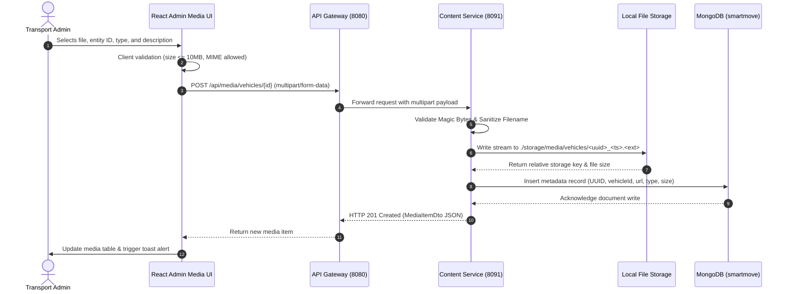

# SmartMove Transport Solutions — Media Management Module Documentation

## 1. Overview & Architectural Vision

The **Media Management Module** is a core operational capability within the **SmartMove Transport Solutions** platform. In public and chartered passenger transport, maintaining up-to-date compliance records (vehicle revenue licenses, fitness certificates, comprehensive insurance policies) and multimedia records (vehicle interior/exterior photographs, route hazard snapshots, trip logs) is mission-critical.

### Hybrid Multi-Model Architecture
SmartMove utilizes a polyglot persistence architecture:
- **Oracle Database 19c/21c (Relational)**: Manages transactional entities requiring ACID guarantees, including `VEHICLES`, `DRIVERS`, `TRIPS`, `BOOKINGS`, and `PAYMENTS`.
- **MongoDB 7.x (Document-Oriented)**: Stores schema-flexible, polymorphic content including customer reviews, public announcements, and **multimedia compliance metadata**.
- **Local File System (`./storage/media/`)**: Stores binary byte payloads (PDFs, PNGs, JPEGs, MP4s). 

> [!NOTE]
> Storing binary blobs directly in MongoDB as Base64 strings inflates document size by ~33% and breaches the 16MB BSON document limit when scaling. Storing files on disk with unique keys and indexing rich metadata in MongoDB provides optimal I/O throughput, low latency byte streaming, and efficient indexing.

---

## 2. System Architecture & Request Flow



### End-to-End File Upload Sequence


---

## 3. MongoDB Data Model & Collection Specifications

The module interacts with two dedicated MongoDB collections within the `smartmove` (or Atlas `SMARTMOVE`) database.

### 3.1 Collection: `vehicle_documents`
Represents compliance certificates and vehicle photographs linked to Oracle `VEHICLE.VEHICLE_ID`.

```json
{
  "_id": "670c53f8101a9b2401f80001",
  "vehicleId": 1,
  "documentType": "REGISTRATION",
  "documentNumber": "WP-CAB-1204-REG",
  "title": "Commercial Passenger Vehicle Revenue License",
  "description": "Annual provincial revenue license valid through 2026",
  "fileUrl": "/api/media/stream/vehicles/sample-reg-1.pdf",
  "storageKey": "vehicles/sample-reg-1.pdf",
  "fileName": "sample-reg-1.pdf",
  "contentType": "application/pdf",
  "fileSizeBytes": 142050,
  "status": "VERIFIED",
  "uploadDate": "2026-10-10T08:30:00.000Z",
  "expiryDate": "2027-10-10T00:00:00.000Z",
  "updatedAt": "2026-10-14T10:00:00.000Z"
}
```

#### Document Type Enumeration:
- `REGISTRATION`: Motor traffic registration certificates
- `INSURANCE`: Third-party and comprehensive passenger liability insurance
- `FITNESS`: Department of Motor Traffic technical roadworthiness certificates
- `EMISSION`: Clean air certification
- `IMAGE`: High-resolution photographs (exterior, interior, emergency exits)
- `OTHER`: Permit cards, logbooks, route passes

### 3.2 Collection: `trip_media`
Represents media captured or attached to passenger journeys linked to Oracle `TRIP.TRIP_ID`.

```json
{
  "_id": "670c53f8101a9b2401f80002",
  "tripId": 1,
  "mediaType": "IMAGE",
  "category": "SCENIC",
  "title": "Southern Expressway Ocean View Pass",
  "description": "Scenic departure point photograph along Route E01",
  "fileUrl": "/api/media/stream/trips/sample-trip-1.jpg",
  "storageKey": "trips/sample-trip-1.jpg",
  "fileName": "sample-trip-1.jpg",
  "contentType": "image/jpeg",
  "fileSizeBytes": 845200,
  "uploadDate": "2026-10-12T14:45:00.000Z",
  "recordedBy": "Admin Operator",
  "status": "APPROVED",
  "updatedAt": "2026-10-14T10:00:00.000Z"
}
```

#### Supported Legacy Format Compatibility
Existing seeds may contain hierarchical nested arrays:
```json
{
  "_id": "670c53f8101a9b2401f80099",
  "vehicleId": 1,
  "documents": [
    {
      "id": "DOC-001",
      "name": "fitness_report.pdf",
      "type": "FITNESS",
      "fileUrl": "/api/documents/fitness_report.pdf"
    }
  ],
  "images": [
    {
      "id": "IMG-001",
      "caption": "Bus Front View",
      "url": "https://images.unsplash.com/photo-1544620347-c4fd4a3d5957"
    }
  ]
}
```
The `MediaManagementService` automatically normalizes both flat and nested schemas into standard `MediaItemDto` objects at runtime.

---

## 4. REST API Reference

All endpoints are accessible directly via `content-service` (`http://localhost:8091`) or routed through `api-gateway` (`http://localhost:8080/api/media/**`).

| Method | Endpoint | Description | Request Body | Response Status |
| :--- | :--- | :--- | :--- | :--- |
| `GET` | `/api/media/summary` | Global count & byte statistics | None | `200 OK` |
| `GET` | `/api/media/search` | Search by query keyword & entity type | Query params: `q`, `type` | `200 OK` |
| `GET` | `/api/media/vehicles/{vehicleId}` | List all media for specific vehicle | None | `200 OK` |
| `POST` | `/api/media/vehicles/{vehicleId}` | Upload media for vehicle | `multipart/form-data` | `201 Created` |
| `DELETE`| `/api/media/vehicles/{vehicleId}/{mediaId}` | Delete vehicle media & file | None | `200 OK` |
| `GET` | `/api/media/trips/{tripId}` | List all media for specific trip | None | `200 OK` |
| `POST` | `/api/media/trips/{tripId}` | Upload media for trip | `multipart/form-data` | `201 Created` |
| `DELETE`| `/api/media/trips/{tripId}/{mediaId}` | Delete trip media & file | None | `200 OK` |
| `GET` | `/api/media/stream/{fileKey}` | Stream file content inline (preview) | Path variable | `200 OK` |
| `GET` | `/api/media/download/{fileKey}` | Download file as attachment | Path variable | `200 OK` |

### Sample cURL Requests

#### 1. Retrieve Media Overview
```bash
curl -X GET "http://localhost:8080/api/media/summary" \
     -H "Accept: application/json"
```

#### 2. Upload Vehicle Registration Document
```bash
curl -X POST "http://localhost:8080/api/media/vehicles/1" \
     -F "file=@/path/to/revenue_license_2026.pdf" \
     -F "title=Revenue License 2026" \
     -F "documentType=REGISTRATION" \
     -F "description=Provincial commercial passenger permit" \
     -F "documentNumber=WP-CAD-8901"
```

#### 3. Stream File for In-Browser Rendering
```bash
curl -X GET "http://localhost:8080/api/media/stream/vehicles/sample-reg-1.pdf" \
     --output preview.pdf
```

---

## 5. Security, Validation & Storage Policy

### 5.1 Validation Enforcement
1. **File Size Limit**: Configured at 10MB (`spring.servlet.multipart.max-file-size=10MB`). Files exceeding 10MB are rejected immediately.
2. **File Extension Whitelist**: `.pdf`, `.png`, `.jpg`, `.jpeg`, `.webp`, `.mp4`, `.webm`.
3. **Magic Byte Signature Inspection**: Inspects the binary header bytes to prevent extension spoofing:
   - PDF: `%PDF-` (`0x25 0x50 0x44 0x46`)
   - PNG: `0x89 0x50 0x4E 0x47`
   - JPEG: `0xFF 0xD8 0xFF`

### 5.2 Path Traversal Prevention
Storage keys are generated using UUID v4 and strictly validated against directory traversal attacks:
```java
Path resolved = targetDir.resolve(filename).normalize();
if (!resolved.startsWith(targetDir)) {
    throw new SecurityException("Path traversal attempt detected");
}
```

### 5.3 Git Hygiene
The storage folder `./storage/` is explicitly registered in [.gitignore](file:///C:/Users/SANDANIMNE/Desktop/code%20ss/SmartMove/SmartMove/.gitignore). Media binary artifacts are never committed to version control.

---

## 6. Frontend UI / UX Implementation

The frontend is built with React 18, Tailwind CSS, and Lucide icons, adhering to the SmartMove "ethereal glassmorphism" aesthetic.

### 6.1 Admin Media Management Hub (`/admin/media`)
- **Metric Banners**: Instant visualization of total uploaded items, breakdown of vehicle vs trip media, and real-time disk consumption in megabytes/gigabytes.
- **Categorized Tabs**:
  - `All Media`: Global searchable catalog.
  - `Vehicle Media`: Filterable by Vehicle ID (Bus #1, Van #2, etc.) and document type.
  - `Trip Media`: Filterable by Trip ID and category (Scenic, Hazard, Log).
- **Interactive Upload Dialog**:
  - Drag-and-drop file target with live size indicator.
  - Contextual entity ID selection linked to active fleet vehicles.
  - Error toaster notifications for unsupported MIME types or oversized files.
- **Interactive Preview Modal**:
  - **Images**: High-resolution lightbox with zoom.
  - **PDF Documents**: Embedded interactive viewer with native page navigation and download trigger.
  - **Videos**: HTML5 player with pause/scrub controls.
- **Safe Deletion Protocol**: Two-step deletion dialog with immediate optimistic UI update.

### 6.2 Passenger Media Showcase (`/passenger/media`)
Displays customer-facing route photography and travel media, allowing passengers to view verified images of the fleet before booking journeys.

---

## 7. Automatic Data Seeding on Startup

To enable zero-configuration demonstrations during academic Viva Voce evaluations, `SampleMediaInitializer.java` implements `ApplicationRunner`. Upon `content-service` startup:
1. Verifies if sample physical files exist in `./storage/media/vehicles` and `./storage/media/trips`. If missing, it writes valid sample PDF and PNG binary files.
2. Checks MongoDB `vehicle_documents` and `trip_media` collections. If empty, it creates metadata records mapped to Oracle Vehicle IDs `1`, `2`, `3` and Trip IDs `1`, `2`, `3`.
3. The process is idempotent; running multiple times does not duplicate data.

---

## 8. Live Viva Voce Demonstration Script

### Step 1: Open the Admin Media Console
1. Open Google Chrome and navigate to: `http://localhost:5173/admin/media`.
2. Observe the statistics cards: Total Media, Vehicle Compliance, Trip Records, and Storage.

### Step 2: Upload a Live Compliance Document
1. Click **"+ Upload Media"**.
2. Select **Target Entity**: `Vehicle`.
3. Enter **Vehicle ID**: `1` (Express Luxury Coach - ND-5523).
4. Select **Document Type**: `FITNESS`.
5. Enter **Title**: `Annual Brake & Chassis Inspection Certificate`.
6. Attach a local PDF file.
7. Click **"Upload Media"**.
8. Observe the real-time card addition and success toast.

### Step 3: Verify in MongoDB Shell / Compass
Run the following query in `mongosh` or MongoDB Compass:
```javascript
use smartmove
db.vehicle_documents.find({ vehicleId: 1 }).sort({ uploadDate: -1 }).pretty()
```
*Examiner takeaway*: Point out the clean JSON document schema, file path reference, content type, and byte size.

### Step 4: Verify Physical File on Filesystem
Open the directory:
`services\content-service\storage\media\vehicles\`
*Examiner takeaway*: Show that the physical binary was safely written with a UUID-based filename, demonstrating proper architecture separating metadata from binary storage.

### Step 5: Test In-Browser Preview & Streaming
1. Return to the browser at `http://localhost:5173/admin/media`.
2. Click the **View** button on the newly uploaded document card.
3. Observe that the PDF opens directly within the browser modal without triggering an external download, streamed securely via `GET /api/media/stream/{fileKey}`.

### Step 6: Test Deletion & Atomic Cleanup
1. Click the **Delete** (Trash) icon on the test card.
2. Confirm the action in the prompt.
3. Check the filesystem and MongoDB: both the database record and the physical disk file are deleted atomically.
