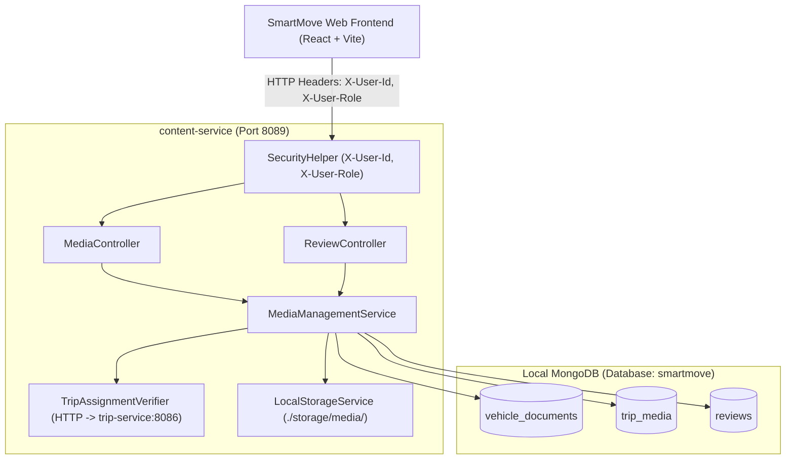

# SmartMove Transport Solutions — Passenger & Driver Media Integration Guide

**Document Version:** 1.0.0  
**Target Services:** `content-service` (Port 8089), `smartmove-web` (Frontend), `trip-service` (Port 8086)  
**Database Engines:** MongoDB (Local `smartmove` database) & Oracle XE (Relational telemetry)  
**System Roles Enforced:** `ADMIN`, `PASSENGER`, `DRIVER` (Strictly 3 roles)

---

## 1. Executive Summary

This document details the architecture, security policy, REST endpoints, MongoDB schemas, and frontend user experiences for the **Passenger** and **Driver** media management capabilities in **SmartMove Transport Solutions**.

The system enables:
- **Passengers** to view verified exterior and interior fleet photography, explore approved scenic trip media galleries, and submit feedback reviews with visual image attachments.
- **Drivers** to inspect assigned vehicle images before departure, review assigned trip media, and upload operational evidence (such as pre-trip/post-trip inspection photos, odometer records, and incident evidence) directly to MongoDB with verified trip assignments.
- **Strict Separation of Concerns & Privacy**: Compliance documents (e.g., insurance certificates, revenue licenses, fitness certificates) and unapproved operational incident evidence are strictly restricted and **never** exposed to passengers.

---

## 2. Role-Based Access Control (RBAC) Matrix

| Resource / Action | PASSENGER | DRIVER | ADMIN |
|---|:---:|:---:|:---:|
| **Public Vehicle Images** (`GET /api/media/vehicles/{id}/public-images`) | ✅ Allowed | ✅ Allowed | ✅ Allowed |
| **Private Compliance Documents** (Insurance, Fitness, Registration) | ❌ **FORBIDDEN (403)** | ❌ **FORBIDDEN (403)** | ✅ Full Access |
| **Approved Trip Photography** (`GET /api/media/trips/{id}`) | ✅ Allowed (`isPublic=true`) | ✅ Allowed (All for assigned trip) | ✅ Full Access |
| **Unapproved / Internal Trip Evidence** | ❌ **FORBIDDEN (403)** | ✅ Allowed (Assigned trip only) | ✅ Full Access |
| **Driver Evidence Upload** (`POST /api/media/trips/{id}/driver-upload`) | ❌ **FORBIDDEN (403)** | ✅ Allowed (Assigned trip verified) | ✅ Allowed |
| **Evidence / Media Deletion** (`DELETE /api/media/{id}`) | ❌ **FORBIDDEN (403)** | ✅ Allowed (Own uploads only) | ✅ Full Access |
| **Review Image Upload** (`POST /api/reviews/{id}/attachments`) | ✅ Allowed (Own reviews) | ❌ Not Applicable | ✅ Full Access |
| **Review Attachment Streaming** (`GET /api/reviews/{id}/attachments/{attId}`) | ✅ Allowed | ✅ Allowed | ✅ Full Access |

---

## 3. Architecture & Microservice Integration



### Security Extraction Mechanism (`SecurityHelper.java`)
Requests carry authentication headers injected by the frontend API client:
- `X-User-Id`: Numeric ID of the authenticated user.
- `X-User-Email`: Email address.
- `X-User-Role`: One of `ADMIN`, `PASSENGER`, `DRIVER`.

### Trip Assignment Verification (`TripAssignmentVerifier.java`)
When a driver uploads evidence to a trip, the backend calls `trip-service` (`http://localhost:8086/api/trips/{id}`) to verify that the driver's ID matches `driverId` on the trip record. If mismatched, the request is rejected with `403 FORBIDDEN`.

---

## 4. Backend REST Endpoints & Contracts

### 4.1 Passenger & Fleet Endpoints

#### `GET /api/media/vehicles/{id}/public-images`
- **Access:** Public / Passenger / Driver / Admin
- **Description:** Returns only public vehicle exterior/interior images. Compliance documents and private certificates are stripped.
- **Response:** `200 OK` with `List<MediaItemDto>`

#### `POST /api/reviews/{reviewId}/attachments`
- **Access:** Passenger (author) / Admin
- **Content-Type:** `multipart/form-data` (field: `file`)
- **Constraints:** Up to 3 attachments per review; <= 5MB; JPEG, PNG, WebP only.
- **Response:** `200 OK` with updated `Review` document containing the new attachment metadata.

#### `GET /api/reviews/{reviewId}/attachments/{attachmentId}`
- **Access:** All authenticated roles
- **Description:** Streams or serves the review attachment binary with proper `Content-Type` and `Cache-Control`.

---

### 4.2 Driver Endpoints

#### `POST /api/media/trips/{tripId}/driver-upload`
- **Access:** Driver assigned to the trip, or Admin
- **Content-Type:** `multipart/form-data`
- **Parameters:**
  - `file`: MultipartFile (max 5MB; JPEG, PNG, WebP, PDF)
  - `category`: `PRE_TRIP_INSPECTION` | `POST_TRIP_INSPECTION` | `INCIDENT` | `VEHICLE_CONDITION` | `PHOTO`
  - `caption`: Optional description or inspection notes
  - `isPublic`: Optional boolean (default `false`). If `true`, the photo will still require administrative dispatch approval (`approvalStatus: PENDING_REVIEW`) before becoming visible to passengers.
- **Audit Fields Stored:**
  - `uploaderRole`: `DRIVER`
  - `driverId`: driver's authenticated user ID
  - `approvalStatus`: `PENDING_REVIEW`
  - `isPublic`: requested visibility flag
- **Response:** `201 CREATED` with `MediaItemDto`

#### `DELETE /api/media/{id}`
- **Access:** Admin, or Driver who uploaded the file
- **Description:** Deletes physical file from local storage and removes the document from MongoDB. If a driver attempts to delete media uploaded by someone else or another driver, returns `403 FORBIDDEN`.
- **Response:** `204 NO CONTENT`

---

## 5. MongoDB Collections & Document Schemas

### 5.1 Collection: `trip_media`
```json
{
  "_id": { "$oid": "660c1a8f9b1d8b2e3f4a5c90" },
  "tripId": 1001,
  "routeId": 101,
  "driverId": 2,
  "vehicleId": 1,
  "mediaType": "IMAGE",
  "category": "PRE_TRIP_INSPECTION",
  "originalFileName": "pre-trip-tyres-inspection.jpg",
  "storedFileName": "a4b8823d-4c3e-4b68-b806-38290f8976b1_1712839200000.jpg",
  "storageKey": "trips/a4b8823d-4c3e-4b68-b806-38290f8976b1_1712839200000.jpg",
  "contentType": "image/jpeg",
  "fileSize": 1284920,
  "caption": "Tyre pressure checked, emergency exit clear, brake fluid level optimal.",
  "isPublic": false,
  "approvalStatus": "PENDING_REVIEW",
  "uploaderRole": "DRIVER",
  "uploadedAt": { "$date": "2026-10-14T23:30:00.000Z" }
}
```

### 5.2 Collection: `vehicle_documents`
```json
{
  "_id": { "$oid": "660c1a8f9b1d8b2e3f4a5c01" },
  "vehicleId": 1,
  "documentType": "EXTERIOR_PHOTO",
  "fileName": "wp-nd-4521-exterior.png",
  "storageKey": "vehicles/550e8400-e29b-41d4-a716-446655440000_1712839200000.png",
  "contentType": "image/png",
  "fileSize": 2048500,
  "isPublic": true,
  "status": "APPROVED",
  "uploadedAt": { "$date": "2026-10-14T20:00:00.000Z" }
}
```

### 5.3 Collection: `reviews` (with attachments)
```json
{
  "_id": { "$oid": "660c1a8f9b1d8b2e3f4a5d88" },
  "routeId": 101,
  "passengerId": 5,
  "passengerName": "Kasun Perera",
  "rating": 5,
  "comment": "Smooth ride to Galle and very comfortable luxury seating. The bus arrived on time!",
  "type": "REVIEW",
  "tags": ["Comfort", "Punctuality", "Cleanliness"],
  "attachments": [
    {
      "id": "770a1a8f9b1d8b2e3f4a5e12",
      "fileName": "galle-bus-interior.jpg",
      "storageKey": "reviews/770a1a8f9b1d8b2e3f4a5e12_1712839500000.jpg",
      "contentType": "image/jpeg",
      "fileSize": 845230,
      "url": "/api/reviews/660c1a8f9b1d8b2e3f4a5d88/attachments/770a1a8f9b1d8b2e3f4a5e12",
      "uploadedAt": "2026-10-14T23:45:00.000Z"
    }
  ],
  "createdAt": "2026-10-14T23:45:00.000Z"
}
```

---

## 6. Frontend UI Components

### 6.1 Passenger Media Gallery (`src/pages/passenger/media/Media.tsx`)
- **Dual Tab Architecture:** Toggle between **Trip Photography** (scenic landmarks, passenger experiences) and **Public Fleet Gallery** (commercial coaches, interior seating, verified coach photos).
- **Search & Filters:** Search by title or vehicle registration, and filter by vehicle selection.
- **Lightbox Preview:** Click any photo to open a responsive high-resolution preview with caption, date, and verified fleet badges.

### 6.2 Passenger Trip Booking Fleet Preview (`src/pages/passenger/trips/SearchTrips.tsx`)
- In the **Trip Details Modal**, a dedicated **Verified Coach Photos** strip displays exterior and interior imagery of the scheduled coach.
- Passengers can inspect the vehicle before confirming their seat booking.

### 6.3 Passenger Review Attachments (`src/pages/passenger/feedback/Feedback.tsx`)
- When writing a review or filing a complaint, passengers can attach up to 3 photos (<= 5MB each).
- Live thumbnail previews with one-click remove buttons.
- Files are uploaded directly to the review document in MongoDB via `/api/reviews/{id}/attachments`.

### 6.4 Driver Trip Details & Evidence (`src/pages/driver/trips/TripDetails.tsx`)
- **Assigned Vehicle Photos:** Shows verified coach photos in the Right Column so the driver can visually verify the physical bus before departure.
- **Assigned Trip Evidence Section:** Displays all operational evidence submitted for this trip, with status badges (`PENDING_REVIEW`, `APPROVED`, `REJECTED`) and visibility badges (`Public Photo` vs `Private Dispatch`).
- **Upload Evidence Modal:** Drivers can upload Pre-Trip Inspection, Post-Trip Handover, Vehicle Cleanliness, or Incident Evidence (JPEG, PNG, WebP, PDF).
- **Delete Ownership:** Drivers can remove their own evidence records; other records have the delete button disabled.
- **Full Lightbox / Document Viewer:** Drivers can inspect photos or download attached PDF inspection reports.

### 6.5 Driver Dashboard Quick Link (`src/pages/driver/dashboard/DriverDashboard.tsx`)
- An **Evidence** button is embedded directly on the active trip card, giving drivers 1-click access to the inspection checklist and evidence upload form.

---

## 7. Verification & Test Results

### Backend Automated Test Suite
- **Command:** `mvn test -pl services/content-service`
- **Results:**
  - `MediaControllerTest`: 11 tests passed (100% success)
    - Verification of public vehicle image filtering
    - Verification of role-based document stripping (passengers cannot see private certificates)
    - Verification of driver evidence uploads and trip assignment authorization
    - Verification of driver delete ownership rules
    - Verification of review attachment uploads and downloads
  - `LocalStorageServiceTest`: 7 tests passed (100% success)
    - File storage, collision-free naming, directory security, MIME validation, and safe deletion
  - **Total Tests:** 18
  - **Failures:** 0
  - **Errors:** 0
  - **Status:** `BUILD SUCCESS`

### Frontend TypeScript Compilation & Production Build
- **Command:** `npm run build` (in `frontend/smartmove-web`)
- **Results:**
  - TypeScript compiler (`tsc`): 0 errors
  - Vite production bundle: 3,196 modules transformed
  - Assets generated in `dist/`
  - **Status:** `SUCCESS`
